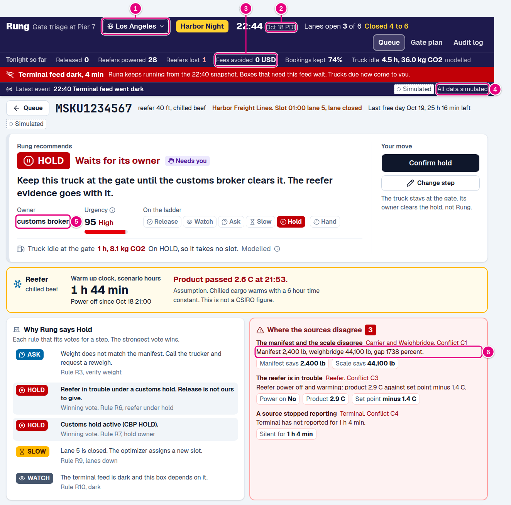
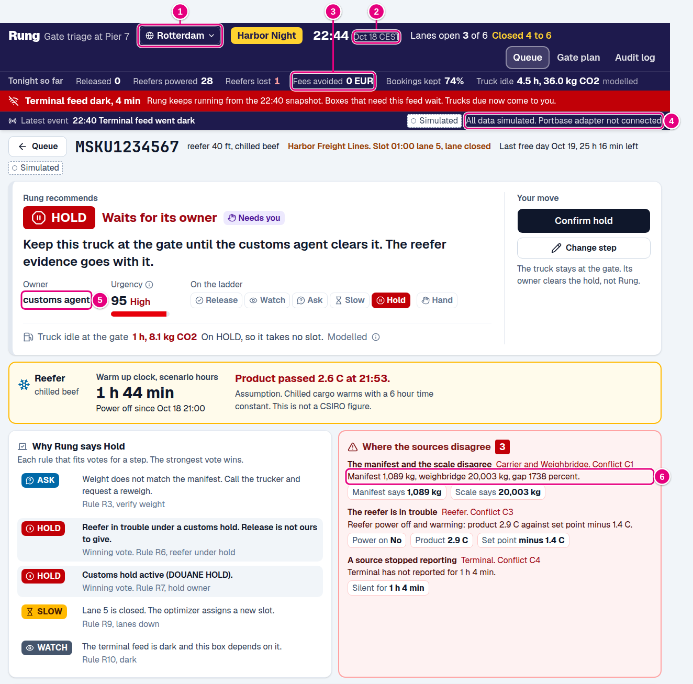
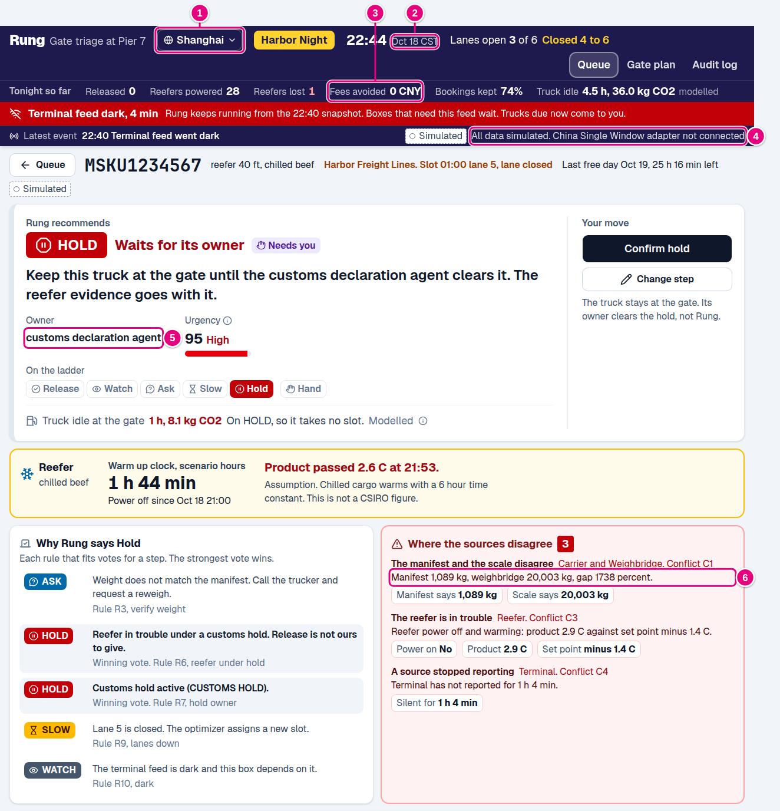

# Rung, global

**Pitch line.** Every port has five systems that disagree about one box, so the Rung ladder, trust
model, and gate plan travel unchanged. Switch the region to Rotterdam or Shanghai and only the data
adapters, the units, and the names of who holds the box change.

**Poster panel.** Global by design. The decision core never changes: one ladder, one trust model, one
gate optimizer, and a person approves every hold. A region profile swaps the edges: Portbase or the
China Single Window for Terminal49, kg and euros or yuan, Douane or China Customs for CBP. Lagos, where
trucks queue for days, needs it most.

The twist, received Sat Oct 17 at about 5:00 PM Pacific: "Let's make it global. How does the same
solution hold up in another part of the world?" This page answers it in two parts. First, what stays
the same everywhere and why. Second, what changes port by port, and where in Rung each change lands.
The last section shows the region switch that is in the app today.

## What stays the same everywhere

Rung reasons about one question that every container port shares: five sources describe the same box,
some of them disagree or go quiet, and a truck is waiting. None of the parts below knows which country
it runs in, and none of them changes with the region switch.

| Part | Why it travels |
| --- | --- |
| **The ladder** | Release, Watch, Ask, Slow, Hold, Hand. Every terminal can let a truck go, wait, ask, reschedule, hold for an outside party, or call a person. The names of the outside parties change, the steps do not |
| **`evaluate()`** | A pure function of one box and the clock. It reads a reading per source in one shape, so a Portbase reading and a Terminal49 reading look the same to it. It never imports the region code, and a test checks that |
| **Trust and conflicts** | Trust is a base reliability per source, an age decay, and a penalty per conflict. A weight that disagrees with the scale, a record that disagrees with a hold, a reefer in trouble, a dark feed, and a running clock are the same five conflicts in Rotterdam and in Lagos. Only the base trust of each adapter is a local setting |
| **The gate optimizer** | An assignment problem: trucks to lanes and hourly windows at the lowest total cost. Lanes, windows, and capacity are inputs. It does not care whether the slots come from PierPass, Portbase, or a call up system |
| **Human approval** | Rung never places or lifts a customs or line hold anywhere. Every Hold and every Release after a conflict waits for the planner. That is the safe default under every customs law we looked at |
| **The audit log** | Every decision with its reason, actor, and rule ids. Customs audits, insurer claims, and carbon reports in every region ask for exactly this record |

Three global standards make the core portable on its own:

- **ISO 6346** container numbers are the same everywhere, so the box key never changes.
- **SOLAS verified gross mass** has applied to every export container since 2016, so a declared weight checked against a measured weight is a global idea, not a US one. The C1 weight conflict is that check.
- **UN/LOCODE** gives every port a code: USLAX, NLRTM, CNSHA, SGSIN, NGLOS. The region profile carries it.

## What changes, and where Rung absorbs it

| What changes | Where it lands in Rung | In this build |
| --- | --- | --- |
| **Data sources** | One adapter per source, each producing the same reading shape, with its own base trust | Adapter names per region. Terminal49 is the only live adapter, the others are named stubs and the data is simulated |
| **Customs authority and hold owners** | The hold map: hold kind to label and owner. The engine keeps canonical kinds | Done. Labels and owners change per region |
| **Units and currency** | The display edge in the browser and the API edge on the server | Done. kg or lb, USD or EUR or CNY at fixed demo rates |
| **Regulations** | Rules are one file each, so a region adds a rule pack, such as an ICS2 do not load notice that becomes a Hold | Described here, not built |
| **Emissions factors** | A factor table per region, with its sources and reporting rules | The label and the local rules change. The diesel factor stays, because the chemistry of diesel is the same |
| **Language** | The copy module and the voice agent prompt | Described here, not built. Copy stays English |
| **Appointment systems** | Gate optimizer inputs: lanes, windows, capacity, and who books the slot | Described here, not built |
| **Time zone** | The clock label | Done. PDT, CEST, or CST next to the scenario clock |

## Port by port

### Rotterdam, Netherlands

| Topic | What it is there | What Rung changes |
| --- | --- | --- |
| Data sources | **Portbase**, the port community system, carries the shipping line's commercial release, the terminal status, customs status, and the truck pre notification for road | A Portbase adapter feeds the carrier, terminal, and customs sources. Weighbridge and reefer stay terminal feeds |
| Customs and hold owners | **Dutch Customs (Douane)** under the EU Union Customs Code. **ICS2** needs safety and security data before a box is loaded abroad, and a do not load notice or a referral can stop it. **NVWA** inspects food, plants, and animal products at the border control post. The shipping line gives commercial release | Customs hold label DOUANE HOLD, owner the **customs agent**. The USDA slot becomes **NVWA**, the VACIS slot becomes **Douane scan**. Line and freight holds still belong to the shipping line |
| Units and currency | Kilograms, euros, 24 hour clock. Dutch writes 1.089 kg with a dot for thousands | kg and EUR. A Dutch locale would also swap the number separators |
| Regulations | The EU ETS has covered ship emissions since 2024. FuelEU Maritime started in 2025. Road fuel joins a second carbon market, EU ETS 2, later this decade. EU driving time rules limit how long a driver can wait and still drive | A rule pack for ICS2 notices. Driving time becomes an input to Slow, because a driver out of hours cannot take a later slot |
| Emissions | Same diesel chemistry, about 2.69 kg CO2 per litre. Reporting follows ISO 14083 and the GLEC Framework | The label reads in litres. The factor and its sources stay. A carbon price per tonne could turn idle CO2 into euros |
| Language | Dutch and English. Many drivers come from elsewhere in Europe | The voice agent needs Dutch, English, and the common driver languages |
| Appointments | Pre notification through Portbase, with time slots at the deep sea terminals | Slots come from Portbase instead of the scenario file |

### Shanghai or Ningbo, China

| Topic | What it is there | What Rung changes |
| --- | --- | --- |
| Data sources | The **China International Trade Single Window** for declarations and customs release. Terminal operator systems, such as the Shanghai International Port Group or the Ningbo Zhoushan Port Group. Carrier EDI | Single Window adapter for customs, terminal operator EDI for the terminal, carrier EDI for the carrier. Data laws in China favor keeping data in the country, so Rung would run on a server in China |
| Customs and hold owners | The **General Administration of Customs of China (GACC)**. Since 2018 it also runs inspection and quarantine. Release comes through the Single Window. The shipping line issues the electronic equipment interchange receipt that lets a truck take the box | Customs hold label CUSTOMS HOLD, owner the **customs declaration agent**. The USDA slot becomes **Quarantine**, the VACIS slot becomes **Customs scan** |
| Units and currency | Kilograms, yuan, UTC plus 8 | kg and CNY |
| Regulations | The national carbon market covers power and is expanding to heavy industry, not trucks. China VI emission standards apply to heavy trucks | No new rule for carbon. A rule for a missing equipment interchange receipt would vote Ask |
| Emissions | Same diesel factor. A growing share of trucks run on electricity or LNG, so the factor depends on the fleet and on the grid | Factor per fuel type, chosen by the truck's fuel when the appointment says it |
| Language | Mandarin Chinese. Drivers are often reached through WeChat rather than a phone call | Voice agent in Mandarin, and a message channel next to the call |
| Appointments | Terminal truck appointment platforms run by the terminal operators | Slots come from the terminal platform |

### Singapore

| Topic | What it is there | What Rung changes |
| --- | --- | --- |
| Data sources | **Portnet**, the port community system, and the PSA terminal systems at Tuas and Pasir Panjang. Customs permits go through TradeNet, now part of the Networked Trade Platform | Portnet adapter for carrier and terminal, a permit adapter for customs |
| Customs and hold owners | **Singapore Customs** issues permits. **ICA** checks cargo at the checkpoints. The **Singapore Food Agency** controls food imports. The declaring agent files the permit | Customs hold owner the **declaring agent**. The USDA slot becomes **SFA**, the VACIS slot becomes **ICA check** |
| Units and currency | Kilograms, Singapore dollars, UTC plus 8 | kg and SGD |
| Regulations | A carbon tax on large emitters, 25 SGD a tonne in 2024 and 2025 and 45 SGD in 2026 and 2027. Idling a stationary vehicle is an offence | An idling rule turns long modelled idle into a compliance flag, not only CO2 |
| Emissions | Same diesel factor | The carbon tax gives an optional cost per tonne |
| Language | English | No change to copy |
| Appointments | Haulier bookings through Portnet. Most boxes in Singapore move ship to ship, so the gate carries a small share of the volume | The ladder also fits yard moves between ships, with lanes replaced by cranes and berth windows |

### Lagos, Nigeria (an emerging port with severe truck queues)

| Topic | What it is there | What Rung changes |
| --- | --- | --- |
| Data sources | Terminal records at Apapa, Tin Can Island, and the newer Lekki port. The **Eto** electronic call up system that the Nigerian Ports Authority uses to schedule trucks into the port. Much of the rest arrives by phone, SMS, or WhatsApp | A manual source with low base trust, so typed updates count less than system records. Dark feed handling and the voice agent matter most here |
| Customs and hold owners | The **Nigeria Customs Service**, with physical examinations common. **NAFDAC** for food and drugs, **SON** for standards. A licensed customs agent files the entry | Customs hold owner the **licensed customs agent**. The USDA slot becomes **NAFDAC** |
| Units and currency | Kilograms, naira. The naira has moved fast against the dollar, and many port charges are quoted in dollars | A daily exchange rate source instead of a fixed demo rate, and fees shown in the currency they are billed in |
| Regulations | The Climate Change Act of 2021. No carbon price on trucks | No carbon rule. A rule for an expired call up ticket would vote Slow |
| Emissions | Older trucks and very long queues. Trucks have waited days on the access roads, so local air quality matters as much as CO2 | The one hour idle cap is a US assumption. Lagos needs a cap in days and a factor for older engines |
| Language | English, Nigerian Pidgin, Yoruba, and Hausa | Voice agent in Nigerian English and Pidgin first |
| Appointments | Eto call up tickets and holding truck parks outside the port | Slots come from Eto, and the gate plan covers the truck park as well as the gate |

Grid power is unreliable in Lagos, so many reefers run on generator sets. The silent reefer classifier,
which tells a tripped circuit from a failed unit from a telemetry fault, is worth more there than in Los
Angeles.

Mombasa, Kenya is the other strong candidate. The Kenya Revenue Authority runs customs, KenTrade runs
the single window, and much of the import volume now leaves by the Standard Gauge Railway to the
Nairobi inland depot. There the gate plan would cover rail slots as well as truck lanes.

## In the app today: the region switch

A **Region** menu sits in the header next to the terminal name. Los Angeles is the default. Rotterdam
and Shanghai are the other two profiles. Switching changes the words, units, and labels the planner
reads, and nothing that Rung decides.

| Field | Los Angeles | Rotterdam | Shanghai |
| --- | --- | --- | --- |
| Weight | lb | kg | kg |
| Money | USD | EUR at 0.86 per USD | CNY at 7.1 per USD |
| Customs authority | U.S. Customs and Border Protection (CBP) | Dutch Customs (Douane) | General Administration of Customs of China (GACC) |
| Customs hold owner | customs broker | customs agent | customs declaration agent |
| USDA, VACIS, TMF slots | USDA, VACIS, TMF | NVWA, Douane scan, Terminal fee | Quarantine, Customs scan, Terminal fee |
| Data adapter | Terminal49 | Portbase (stub) | China Single Window (stub) |
| CO2 label | 0.8 gallon an hour, 10.18 kg per gallon | 3.0 litres an hour, 2.69 kg per litre, plus EU ETS | 3.0 litres an hour, 2.69 kg per litre, plus the national carbon market |
| Time zone label | PDT | CEST | CST |

The exchange rates are fixed demo rates, labeled as such, not live quotes. The scenario stays the same
night shift, so the wall clock still reads 22:00 at the start, now at the chosen port.

1. **Region.** The switch. Every other numbered item follows it.
2. **Time zone label.** PDT, CEST, or CST next to the scenario date.
3. **Fees avoided.** In USD, EUR, or CNY.
4. **Data source chip.** Names the adapter for the region. Outside Los Angeles it says the adapter is not connected, because only Terminal49 is live in this build.
5. **Owner.** The customs broker, customs agent, or customs declaration agent.
6. **The weight conflict.** 2,400 lb against 44,100 lb, or 1,089 kg against 20,003 kg. Same conflict, same step, same urgency of 95.

### How it is built

- `backend/regions.py` holds the three profiles and `localize()`. A middleware in `backend/main.py` runs `localize()` on every JSON response from `/api/` except the voice agent prompt and the Retell functions. It rewrites generated sentences only: "2,400 lb" becomes "1,089 kg", "440 USD" becomes "378 EUR", and "customs broker" becomes the local owner. Identifiers such as step names, rule ids, hold kinds, and box numbers pass through.
- `frontend/src/region.ts` converts numbers at display: weights, fees, and hold labels. The spoof form takes kilograms in Rotterdam and Shanghai and sends pounds to the API.
- `POST /api/region {"region": "rotterdam"}` switches the profile. `GET /api/state` returns the profile and the list of regions.
- `evaluate()`, the rules, trust, the ladder, and the gate optimizer are untouched. `tests/test_regions.py` checks that every decision and the gate plan are identical in all three regions, and that the engine and rule files never import the region code.

## What it would take to go live in a new port

1. Write the adapters for that port's systems, each producing the five reading shapes, and set each adapter's base trust.
2. Fill the hold map with the local authorities, hold kinds, and owners.
3. Add the rule pack for local notices, such as ICS2 in the EU or call up tickets in Lagos.
4. Set the emissions table, the idle cap, and the exchange rate source.
5. Translate the copy module and the voice agent prompt.
6. Point the gate optimizer at the local appointment system.

The ladder, `evaluate()`, trust, conflicts, the optimizer, human approval, and the audit log ship as they
are.
