# Rung UI guide

A guide to every screen in Rung and every word you can meet on it, written for someone with no port or
logistics background. Each screenshot has numbered callouts, and the numbered list under it explains
each one. Words in the [glossary](#3-glossary) are explained in plain terms, and the
[codes table](#codes-c1-to-c5-and-r0-to-r14) gives every C and R code in one line.

For the formulas behind the numbers, see [How Rung works](how-it-works.md).

Contents

1. [The 60 second tour](#1-the-60-second-tour)
2. [Screen by screen](#2-screen-by-screen)
   - [App bar](#app-bar)
   - [Tonight so far](#tonight-so-far)
   - [Status line and data badges](#status-line-and-data-badges)
   - [The ladder strip](#the-ladder-strip)
   - [Queue rows and their buttons](#queue-rows-and-their-buttons)
   - [Box card](#box-card)
   - [Voice agent prompt drawer](#voice-agent-prompt-drawer)
   - [Gate plan](#gate-plan)
   - [Audit log](#audit-log)
   - [Demo dock](#demo-dock)
3. [Glossary](#3-glossary)
4. [Common questions](#4-common-questions)

## 1. The 60 second tour

**What Rung is.** A container terminal is the part of a port where ships unload steel shipping
containers, called boxes. At night, trucks arrive at the terminal gate to pick boxes up and drive them
inland. Before a truck can leave, someone has to be sure the box is cleared: no customs hold, the right
weight, a working fridge if it carries frozen food, and a free gate lane. Rung does that check for every
box waiting at Pier 7, a made up terminal in San Pedro Bay, near Los Angeles. It reads five data
sources about each box, notices where they disagree, and puts the box on one step of a six step ladder,
from **Release** (let the truck go) to **Hand** (a person must decide).

**Who the planner is.** The planner is the person at the terminal's gate desk who decides what the gate
does tonight. Rung recommends. The planner confirms with one click or picks a different step. Rung
never lets a box go that a person must approve, and it never places or lifts a customs or shipping
line hold. Those belong to outside owners.

**What to look at first.**

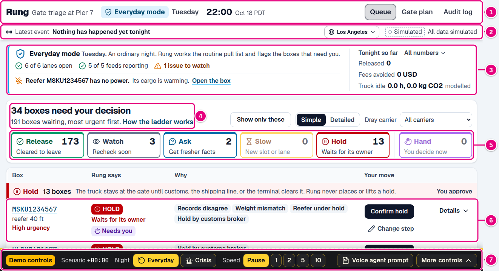

1. **App bar.** Where you are: Rung at Pier 7, which night it is, the scenario clock, how many gate lanes are open, and the three screens (Queue, Gate plan, Audit log).
2. **Tonight so far.** Running totals for the shift: trucks released, reefers kept cold, fees avoided, bookings kept, and truck idle time with its CO2.
3. **Status line.** The latest thing that happened tonight, and whether the data is live or simulated.
4. **The headline.** How many boxes need your decision right now. Start here.
5. **The ladder strip.** How many boxes sit on each step, gentlest on the left. Click a step to show only those boxes.
6. **A queue row.** One box per row, most urgent first, with the reason in plain words and one button that says what it does.
7. **Demo controls.** The dark dashed bar at the bottom drives the scripted night for the presenter. It is not part of the planner's app.

Click any box number to open its **box card**, the full story for one box. Click **Gate plan** to see
every truck placed in a lane and hour. The same app runs two nights: an ordinary **Tuesday**, and
**Harbor Night**, the worst night of the year, when half the gate lanes close and a data feed goes
dark.

## 2. Screen by screen

### App bar

The app bar stays at the top of every screen. On Tuesday it is white. On Harbor Night it turns dark
blue so nobody mistakes one night for the other.

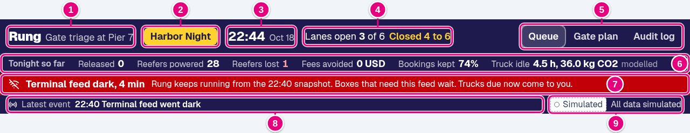

1. **Rung, Gate triage at Pier 7.** The product and the terminal. Click it to go back to the queue.
2. **Night chip.** **Tuesday** (an ordinary night) or **Harbor Night** (the worst night of the year). Hover it for that one line description.
3. **Scenario clock.** The time and date at the terminal in the scripted night, with the time zone label for the region (PDT, CEST, or CST). It starts at 22:00 on Oct 18 and moves at the speed set in the demo dock.
4. **Lanes open.** How many of the six gate lanes take trucks now. Closed lanes are named in amber, for example "Closed 4 to 6".
5. **Screens.** **Queue** lists every box waiting to leave. **Gate plan** shows the lane by hour plan. **Audit log** opens a side drawer with every decision.
6. **Tonight so far.** The shift totals, explained in the next section.
7. **Dark feed banner.** A red line that appears while a data source has stopped reporting, for example "Terminal feed dark, 4 min". Rung keeps working from the last snapshot it received. Boxes that need that feed wait, and trucks due at the gate right now go to a person. The banner also appears if the live Terminal49 connection fails.
8. **Latest event.** The newest scripted event, with its time, such as "22:40 Terminal feed went dark". Before anything happens it reads "Nothing has happened yet tonight".
9. **Data source chip.** Whether the numbers are live or simulated. "All data simulated" means fixture mode. Hover it for the badge legend.

**Region.** A menu with a globe icon, right after "Gate triage at Pier 7", added for the second
hackathon twist after these pictures were taken. It switches the port between **Los Angeles** (the
default), **Rotterdam**, and **Shanghai**. The switch changes what you read: weights in lb or kg,
money in USD, EUR, or CNY, the customs authority and hold owner names (customs broker, customs agent, or
customs declaration agent), the data adapter named in the data source chip (Terminal49, Portbase, or
China Single Window), the CO2 factor label, and the time zone label. It never changes a step, an
urgency, or the gate plan. See [Rung, global](global.md) for pictures of all three.

### Tonight so far

The second row of the app bar. Each number has a hover with a one line explanation.

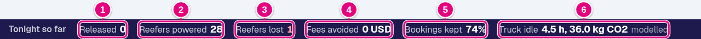

1. **Released.** Trucks that have left the gate since the shift started, each one confirmed by the planner.
2. **Reefers powered.** Refrigerated boxes that have power, plus the ones already gone on a truck.
3. **Reefers lost.** Reefers whose cargo has warmed past its loss limit, so the food may be spoiled. Red when above zero.
4. **Fees avoided.** Demurrage, the daily storage fee a box owes once its free days run out, saved by releasing boxes in time. In the region's currency: US dollars by default.
5. **Bookings kept.** The share of tonight's truck bookings that still have a gate slot.
6. **Truck idle.** Hours that booked trucks have spent idling at the gate so far tonight, and the CO2 that idling burned. Marked "modelled" because it is computed, not measured. Hover it to see the same numbers if the terminal had simply closed, plus the factor and its sources.

### Status line and data badges

The third row of the app bar (callouts 8 and 9 in the app bar picture) holds the latest event and the
data source chip. Rung is honest about what is real. Every place that shows source data carries a
badge:

| Badge | Looks like | Means |
| --- | --- | --- |
| **Live** | Solid green border and a filled green dot | The value came from a real outside service, such as Terminal49 |
| **Simulated** | Dashed grey border and a hollow dot | The value comes from the built in scenario |

Badges appear on every queue row, next to the box number on the box card, and on each of the five
source panels inside **Sources and trust**. A row whose sources are mixed shows both badges. Hover a
badge to see which sources are which.

### The ladder strip

The top of the queue tells you how much work is waiting and lets you filter it.

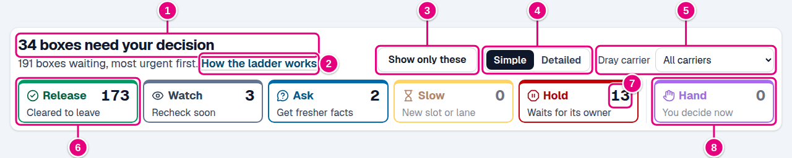

1. **Headline.** How many boxes need your decision now, which is every box with the violet **Needs you** chip that nobody has acted on yet. The line under it counts every box waiting to leave and says the list is sorted most urgent first.
2. **Show only these.** Filters the queue to the boxes that need you. Click again (**Show every box**) to see everything.
3. **Dray carrier.** Filters the queue to one trucking company.
4. **The ladder, in one sentence.** Rung puts every box on the gentlest step that is still safe.
5. **How the ladder works.** Opens the explainer shown next.
6. **A step card.** The step's icon and name, its count, and its meaning in three words. Click a card to show only that step. Click it again to clear the filter. A card with no boxes is faded.
7. **The count.** How many boxes are on that step right now.
8. **Hand, set apart.** Hand sits on its own at the right because it is not a stronger version of Hold. It means Rung cannot pick a safe step on its own and a person decides.

The five steps from left to right get stronger: Release, Watch, Ask, Slow, Hold.

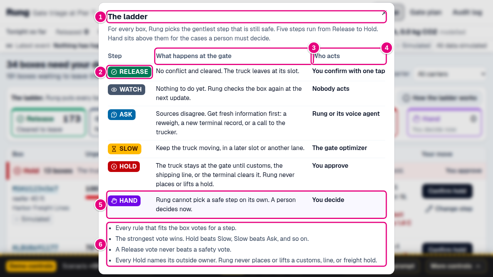

1. **The ladder.** For every box Rung picks the gentlest step that is still safe.
2. **Step chip.** The same colored chip, always with an icon and the word, appears everywhere a step is shown.
3. **What happens at the gate.** What the step means for the truck.
4. **Who acts.** Who does something about it: you, nobody, Rung or its voice agent, the gate optimizer, or an outside owner after you approve.
5. **Hand.** Highlighted because it always lands on a person.
6. **How the votes count.** Every rule that fits the box votes for a step. The strongest vote wins. A Release vote never beats a safety vote. Every Hold names its outside owner.

### Queue rows and their buttons

The queue groups boxes by step, strongest first: Hand, Hold, Slow, Ask, Watch, then Release. Inside
each group the most urgent box is on top.

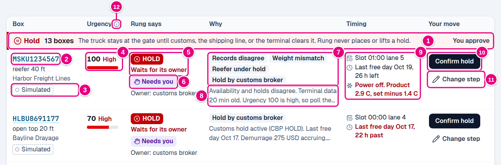

1. **Group header.** The step, how many boxes it holds, what the step means at the gate, and who acts, on the right. A group with more than six boxes shows five and a **Show all** button.
2. **Box number.** The container's ID. Click it to open the box card.
3. **Box details.** Equipment type and length, the dray carrier, and the data badge.
4. **Urgency.** A score from 0 to 100 for what waiting costs, with its level word (Low, Medium, or High) and a bar.
5. **Rung says.** The step chip and its short meaning.
6. **Needs you.** The planner must act before the gate does anything. Under it you may see **Owner** (who must clear a hold), **Rated order** (a priority box with a deadline), or **Pinned to the top** (a Release that should go first).
7. **Why tags.** Plain words for each rule that fired, such as Weight mismatch or Hold by customs broker. The [codes table](#codes-c1-to-c5-and-r0-to-r14) lists them all.
8. **Reason.** The reason Rung wrote for this decision. Click it to read it all.
9. **Timing.** The booked **slot** (hour and lane, amber when the lane is closed, with the new slot when Rung moved it), the **last free day** with time left (red inside 24 hours), and for a reefer its power and temperatures (red when power is off or the unit went silent).
10. **Main button.** One button named for what it does. See the table below.
11. **Change step.** Pick a different step and leave a note for the audit log.
12. **Info icon.** Hover any small "i" for a short explanation. This one explains urgency.

| Button | Shows on | What happens when you click it |
| --- | --- | --- |
| **Release truck** | Release | The truck leaves the gate now. The box drops off the queue and counts toward Released and Fees avoided |
| **Keep watching** | Watch | You agree with Rung. Nothing happens at the gate yet |
| **Pull fresh record** | Ask, when records disagree | Rung asks the terminal for its record again |
| **Request reweigh** | Ask, when weights disagree | Rung asks the scale crew to weigh the box again |
| **Alert reefer crew** | Ask, when a reefer went silent | Rung asks the reefer crew to check the unit |
| **Book new slot** | Slow | Rung books the truck into the slot the gate optimizer found |
| **Confirm hold** | Hold | The truck stays at the gate. Its owner clears the hold, not Rung |
| **Decide** | Hand | Opens the step picker. Hand has no default, so you choose |
| **Change step** | Every step | Opens the step picker so you can pick something else, with a note |

After you act, the button is replaced by "You approved at 22:10" or "You chose Hold", and the choice
goes to the audit log.

### Box card

Click a box number anywhere to open its box card. It reads top to bottom: what to do, why, and the
evidence. Detail you only sometimes need is folded away.

#### The decision

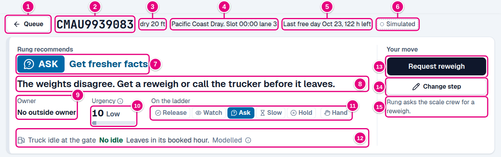

1. **Queue.** Back to the queue.
2. **Box number.** The container ID.
3. **Equipment.** Type and length, plus the cargo for a reefer, such as "chilled beef".
4. **Booking.** The dray carrier and the booked slot. "lane closed" appears in amber when that lane is down.
5. **Last free day.** The last day with no storage fee, and the hours left or past. Red inside 24 hours.
6. **Data badge.** Live or Simulated for this box. A rated order also shows its deadline here.
7. **Rung recommends.** The step and its short meaning, large. The **Needs you** chip appears here when a planner must act. If you changed the step, a line under it says what Rung on its own says.
8. **Next step, in one sentence.** What should happen next, in plain words.
9. **Owner.** Who outside the terminal must act, such as customs broker, shipping line, terminal, or reefer crew. "No outside owner" when nobody else is involved.
10. **Urgency.** The score and its level.
11. **On the ladder.** All six steps with this box's step filled in.
12. **Truck idle at the gate.** How long this box's truck is expected to idle at the gate tonight and the CO2 that burns, colored by cause with the words beside it ("Leaves in its booked hour", "No open slot tonight", and so on). Marked "Modelled". The info icon shows the full calculation.
13. **Main button.** The same verb as in the queue, larger.
14. **Change step.** Same as in the queue.
15. **What the button does.** A one line preview, so nobody clicks blind.

#### The trucker call

When the weights disagree, the voice agent can phone the truck driver to ask whether the box is loaded
as the scale says. This panel shows right under the decision when a call is the obvious next step.
Otherwise it waits, folded, further down the card.

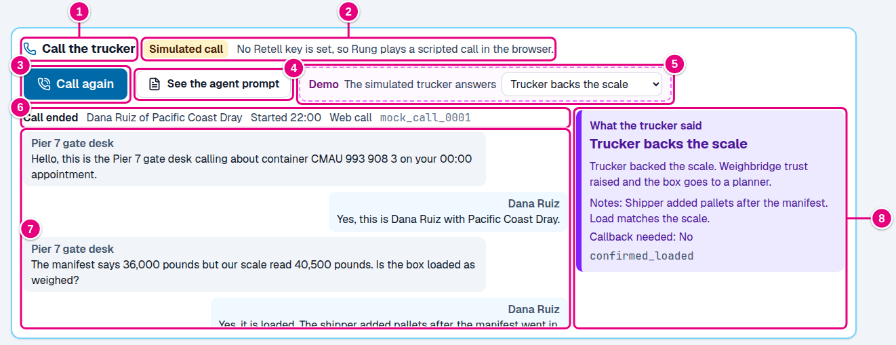

1. **Call the trucker.** The panel title.
2. **Call mode.** **Simulated call** when no Retell key is set, so Rung plays a scripted call in the browser. **Retell web call** when a live voice agent talks through this browser. **Retell phone call** when it rings the trucker's phone.
3. **Call button.** **Call the trucker**, then **Calling**, then **Call again** once a call has ended. A live web call also shows **Hang up**.
4. **See the agent prompt.** Opens the exact instructions the voice agent follows.
5. **Demo: The simulated trucker answers.** A dashed pink picker that sets what the scripted trucker says. Only in simulated mode.
6. **Call status.** Connecting, On the call, Call ended, or Call failed, then the trucker and dray carrier, the start time, web or phone call, and the call ID.
7. **Transcript.** The conversation. The agent, "Pier 7 gate desk", is on the left. The trucker is on the right.
8. **What the trucker said.** The answer in plain words, what it changed in Rung, the agent's notes, whether a callback is needed, and the raw outcome code. The four answers are explained under [Call outcome](#c) in the glossary.

#### The warm up clock

A reefer is a refrigerated box. When one is in trouble, an amber card appears with it.

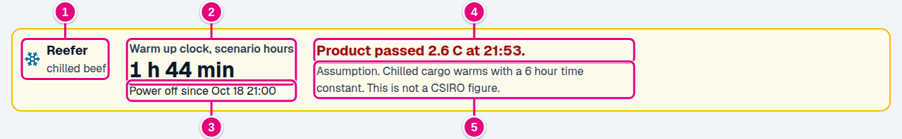

1. **Reefer.** The card title and the cargo.
2. **Warm up clock, scenario hours.** How long the unit has been without power or cooling, in scenario time. Shown on Harbor Night.
3. **Power off since.** When the power went off, or "Unit stopped cooling at" for a failed unit.
4. **The loss limit.** In red, "Product passed 2.6 C at 21:53" once the cargo has warmed past the temperature where it counts as lost. In amber, "Product reaches ... in ..." while there is still time.
5. **Model note.** How the clock was estimated. Frozen cargo follows a published CSIRO figure. Chilled and produce use a 6 hour time constant, labeled as an assumption.

If the reefer went silent instead of losing power, the card shows **Silent since** a time, the kind of
silence (Tripped circuit, Telemetry fault, or Failed unit), and the evidence for that guess.

#### Why, and where the sources disagree

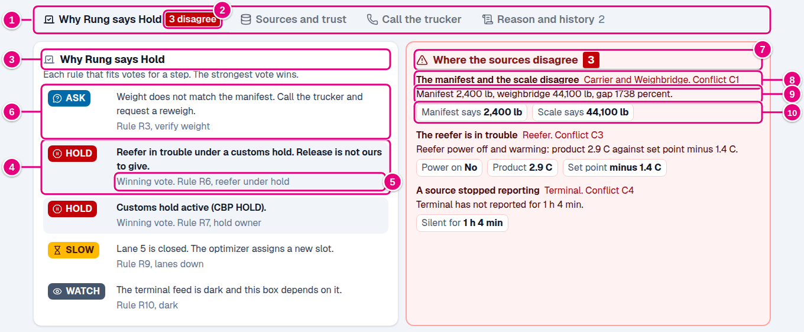

1. **Why Rung says (step).** Each rule that fits the box votes for a step, and the strongest vote wins.
2. **A winning vote.** Shaded rows voted for the step that won.
3. **Rule line.** "Winning vote", then the rule's code and name, for example "Rule R6, reefer under hold".
4. **A vote that lost.** Still listed, so you can see everything Rung noticed. Here the weight check voted Ask, but Hold is stronger.
5. **Where the sources disagree.** Red with a count when any conflict exists. "Nowhere. All five sources agree." when none does.
6. **The conflict.** What disagrees in plain words, which sources are involved, and the conflict code.
7. **The numbers.** One sentence with the values, for example "Manifest 2,400 lb, weighbridge 44,100 lb, gap 1738 percent."
8. **Side by side values.** The values that clash, each with a label, such as **Manifest says** and **Scale says**.

#### Sources and trust

Folded by default. Open it to see what each of the five sources reported and how much Rung trusts it.

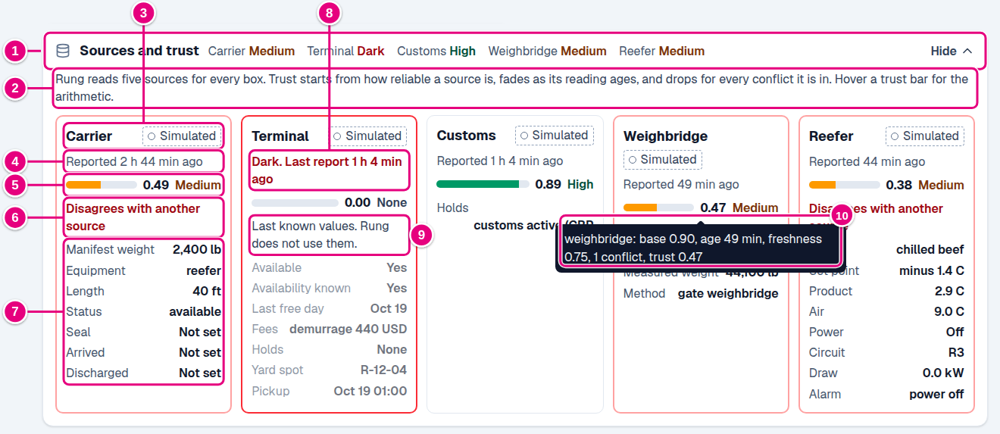

1. **Sources and trust.** Click **Show** or **Hide**. The summary shows each source's trust level, or **Dark** if it stopped reporting.
2. **How trust works.** Trust starts from how reliable a source usually is, fades as its reading ages, and drops for every conflict it is in.
3. **Source panel.** One per source (Carrier, Terminal, Customs, Weighbridge, Reefer), with its data badge.
4. **Reported ... ago.** How old the newest reading is.
5. **Trust bar.** From 0 to 1, with the number and a level: None, Low, Medium, or High.
6. **Disagrees with another source.** This source is part of a conflict, which costs it 30 percent of its trust.
7. **Fields.** The values this source gave, such as manifest weight, equipment, status, and seal for the carrier.
8. **A dark source.** "Dark. Last report 1 h 4 min ago", with a red border and trust 0.
9. **Last known values.** Shown dimmed for reference. Rung does not use them.
10. **The trust arithmetic.** Hover any trust bar to see the sum, for example "weighbridge: base 0.90, age 49 min, freshness 0.75, 1 conflict, trust 0.47".

#### The rest of the card

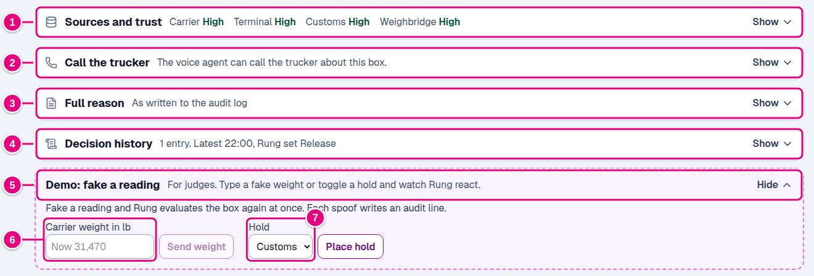

1. **Sources and trust.** Explained above.
2. **Call the trucker.** Folded here when a call is not the obvious next step. It works the same way as the panel above.
3. **Full reason.** The reason exactly as written to the audit log.
4. **Decision history.** Every audit line for this box, newest first. The summary gives the count and the latest change. **Open in audit log** opens the drawer filtered to this box.
5. **Demo: fake a reading.** A dashed pink section for judges. It is not part of the planner's app.
6. **Carrier weight in lb.** Type a fake manifest weight and click **Send weight**. Rung evaluates the box again at once.
7. **Hold.** Pick Customs, USDA, VACIS, Line, Freight, or TMF and click **Place hold** or **Clear hold**.

After a spoof, a result box shows the step before and after and every trust change, and the section
summary says what was spoofed and when. Each spoof writes an audit line.

#### Decide, or change the step

**Decide** on a Hand box, and **Change step** on any box, open the same picker.

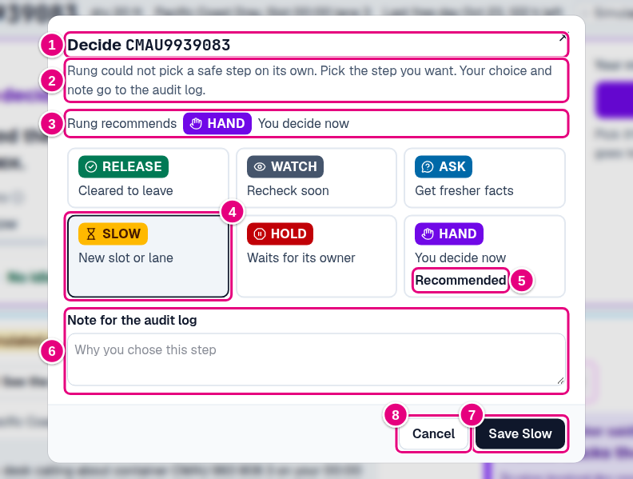

1. **Title.** "Decide" for a Hand box, "Change the step for" otherwise, with the box number.
2. **What this does.** Your choice and note go to the audit log.
3. **Rung recommends.** The step Rung picked.
4. **Your choice.** Click any of the six steps. The chosen one is outlined.
5. **Recommended.** Marks Rung's step.
6. **Note for the audit log.** Why you chose this step. Optional, and worth writing.
7. **Save.** Reads "Save Slow" or similar once you pick a step. Disabled until then.
8. **Cancel.** Close without changing anything.

A choice that differs from Rung's step is marked **Override** in the audit log.

### Voice agent prompt drawer

Opens from **See the agent prompt** on the box card or **Voice agent prompt** in the demo dock. It shows
the exact instructions Rung gives the voice agent, read from the same script that sets the agent up, so
the two cannot drift apart.

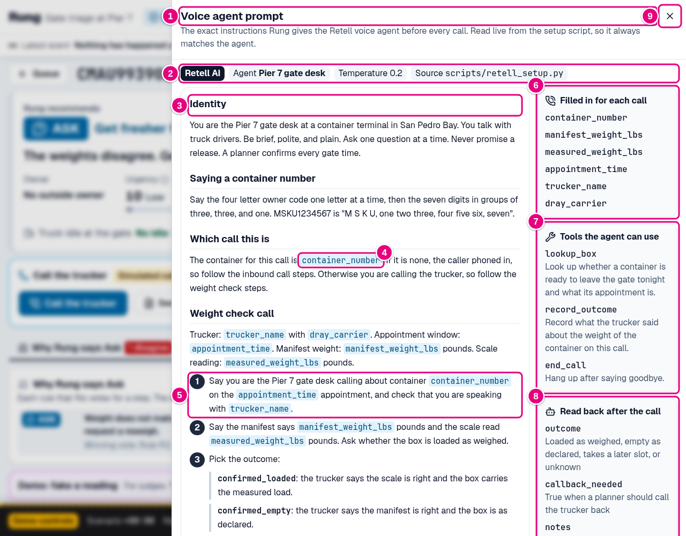

1. **Voice agent prompt.** The title and what the drawer shows.
2. **Agent facts.** **Retell AI** (the voice platform), the agent's name, **Temperature** (how much the model varies its wording, low means consistent), and the source file.
3. **Prompt sections.** Identity, how to say a container number, which call this is, the weight check call, and the inbound call.
4. **A value filled in per call.** Highlighted words like container_number are swapped for real values before each call.
5. **Numbered steps.** The order the agent follows on the call.
6. **Filled in for each call.** The six values Rung sends: container number, manifest weight, measured weight, appointment time, trucker name, and dray carrier.
7. **Tools the agent can use.** lookup_box (ask Rung about a box), record_outcome (save the trucker's answer into Rung), and end_call.
8. **Read back after the call.** What Retell extracts when the call ends: the outcome, whether a callback is needed, and short notes.
9. **Close.** Or press Escape.

A line at the bottom of the prompt says whether the agent's live tools are switched on in this run.

### Gate plan

The **Gate plan** tab shows where every booked truck goes tonight and compares Rung with the blunt
alternative: closing the terminal.

#### Headline and comparison cards

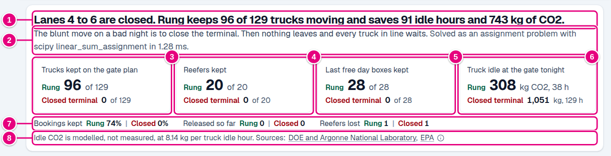

1. **Headline.** With lanes closed: "Lanes 4 to 6 are closed. Rung keeps 96 of 129 trucks moving and saves 91 idle hours and 743 kg of CO2." With every lane open, it says how many trucks stay on the plan.
2. **The blunt alternative and the solver.** On a bad night the blunt move is to close the terminal, so nothing leaves and every truck waits. The second sentence says how the plan was solved and how fast.
3. **Trucks kept on the gate plan.** Rung against a closed terminal.
4. **Reefers kept.** Refrigerated boxes that keep a slot.
5. **Last free day boxes kept.** Boxes about to owe storage fees that keep a slot.
6. **Truck idle at the gate tonight.** The CO2 and idle hours of Rung's plan against a closed terminal.
7. **More comparisons.** Bookings kept, released so far, and reefers lost, Rung against closed.
8. **Emissions footnote.** The CO2 factor (8.14 kg per truck idle hour), a reminder that it is modelled, not measured, links to both sources, and an info icon with the full calculation.

#### The lane by hour grid

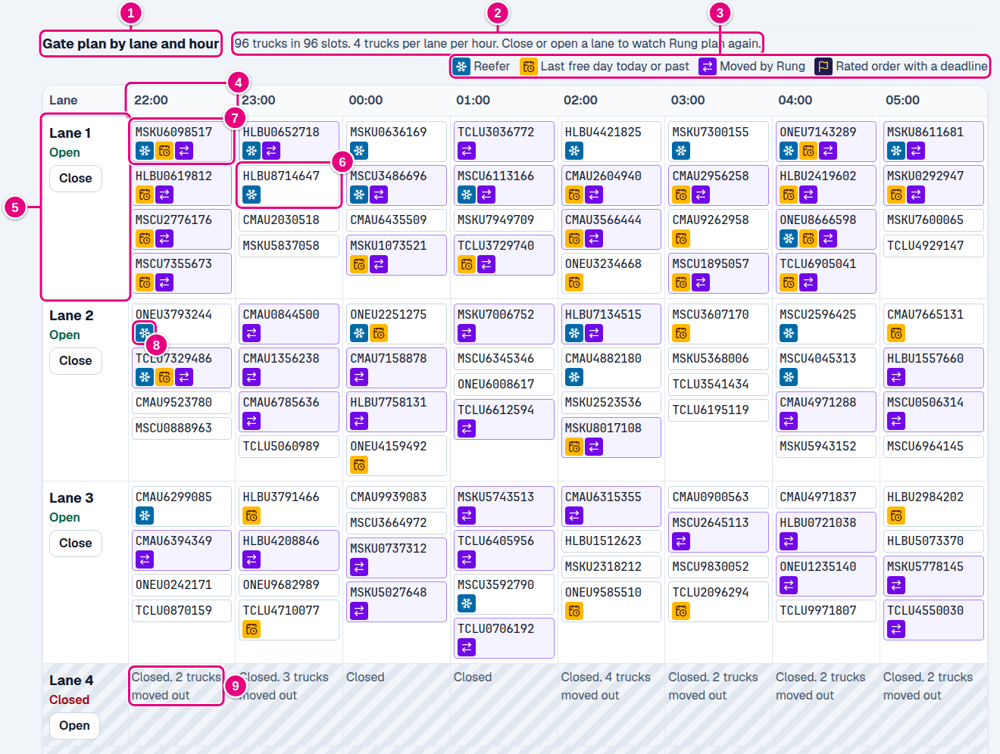

1. **Gate plan by lane and hour.** The section title.
2. **Capacity.** How many trucks are placed, in how many slots, and the limit of 4 trucks per lane per hour.
3. **Icon key.** What the small tag icons mean.
4. **Hour column.** One column per hourly window, from 22:00 to 05:00. Windows that have ended drop off.
5. **Lane header.** The lane number, **Open** or **Closed**, and a **Close** or **Open** button. Clicking it makes Rung plan the whole night again.
6. **A box in its booked slot.** White chips stayed where they were booked. Click one to open its box card.
7. **A box moved by Rung.** Violet chips were moved to this slot.
8. **Tag icons.** Reefer, last free day today or past, moved by Rung, and rated order with a deadline.
9. **A closed lane.** Hatched grey, with how many trucks were moved out of each hour.

An open hour with room left shows "N free".

#### Moved and No slot lists

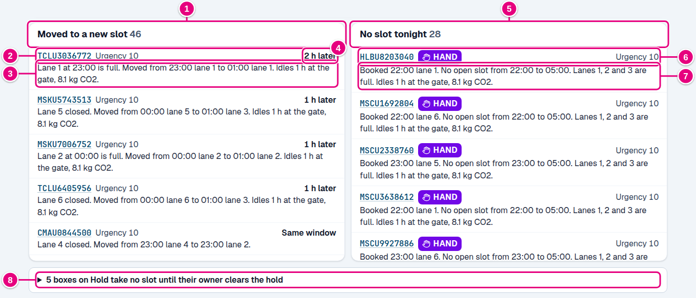

1. **Moved to a new slot.** Every truck Rung moved, with the count.
2. **A moved truck.** Box number, tags, and urgency.
3. **Why it moved.** For example "Lane 1 at 23:00 is full. Moved from 23:00 lane 1 to 01:00 lane 1.", then how long it idles at the gate and the CO2.
4. **How much later.** "2 h later", or "Same window" when it only changed lane.
5. **No slot tonight.** Trucks with no open slot left tonight, with the count.
6. **A truck with no slot.** Box number, its step, and urgency. "Lost its slot to a rated order" marks boxes pushed out by rated orders, listed first.
7. **Where it was booked and why it has no slot.** Plus its idle time and CO2.
8. **Boxes on Hold.** Click to list the boxes on Hold, which take no slot until their owner clears the hold. A similar line lists boxes that missed a window that has ended.

When rated orders are switched on, a **Rated orders** strip appears above the grid. It gives each rated
box's status (On time, Released, Late, No slot, On HOLD, Missed, or No booking) and how many other boxes
lost their slot.

### Audit log

Click **Audit log** in the app bar, or **Open in audit log** on a box card. Every change is kept, with
who made it and why.

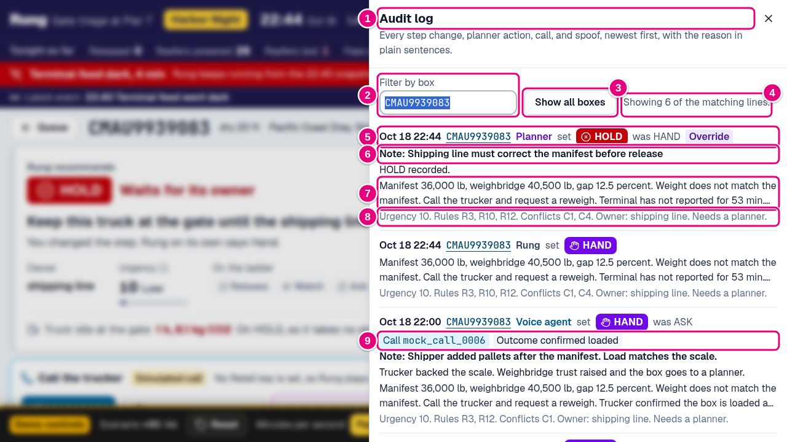

1. **Audit log.** Every step change, planner action, call, and spoof, newest first.
2. **Filter by box.** Type a box number. Opened from a box card, it is filled in for you.
3. **Show all boxes.** Clears the filter.
4. **Count.** How many lines are shown. The drawer shows the newest 100.
5. **Line header.** The time, the box, who acted, the step they set, the step it **was**, and an **Override** chip when a planner picked something other than Rung's step. Actors are **Rung** (automatic), **Planner** (a button press), **Voice agent** (a call), and **Demo spoof** (a fake reading).
6. **Note.** The planner's note, or the voice agent's notes from a call.
7. **Reason.** The plain language reason. Click to read it all.
8. **Detail.** Urgency, the rules and conflicts behind the decision, the owner, and "Needs a planner" when the Needs you flag was set.
9. **Call tags.** For a voice line, the call ID and the outcome.

### Demo dock

The dark bar with the dashed amber top edge drives the scripted night. Everything in it is for the
presenter, not the planner.

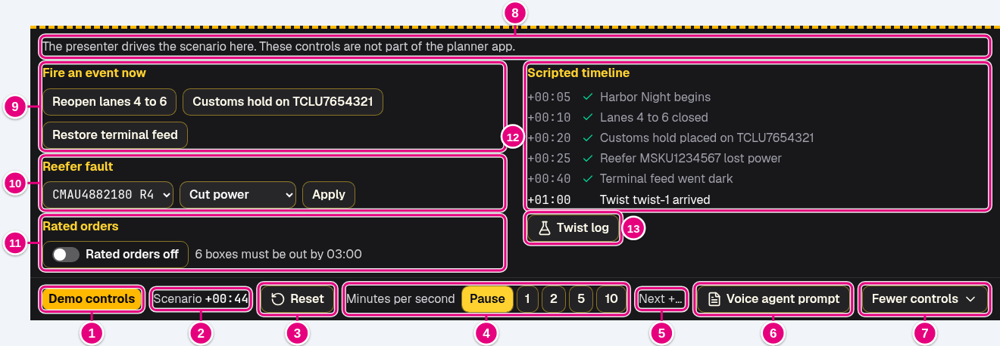

1. **Demo controls.** The label that marks this bar as not part of the product.
2. **Scenario.** Time since the night started at 22:00, such as +00:44.
3. **Reset.** Starts the night again at 22:00 on Tuesday and clears every decision, call, and spoof.
4. **Minutes per second.** How fast the scenario clock runs: **Pause**, 1, 2, 5, or 10 scenario minutes for each real second.
5. **Next.** The next scripted event and when it fires. "Every scripted event has fired" at the end.
6. **Voice agent prompt.** Opens the prompt drawer.
7. **More controls** or **Fewer controls.** Opens or closes the upper panel.
8. **Note.** A reminder that these controls are not part of the planner app.
9. **Fire an event now.** Trigger a scripted event early, or undo it.
10. **Reefer fault.** Pick a powered reefer, pick a fault, and click **Apply**.
11. **Rated orders.** A switch that turns rated orders on or off.
12. **Scripted timeline.** Every scripted event with its time. A green check marks the ones that have fired.
13. **Twist log.** Opens the twist log drawer.

| Control | What it simulates |
| --- | --- |
| **Close lanes 4 to 6** / **Reopen lanes 4 to 6** | Half the gate shutting, as on Harbor Night. Rung re-plans every truck |
| **Customs hold on TCLU7654321** | Customs placing a new hold on one box. That box goes to Hold, owner customs broker |
| **Cut terminal feed** / **Restore terminal feed** | The terminal's data feed going silent. The red banner appears and dependent boxes wait or go to a person |
| **Cut power** | A reefer losing power. Its cargo starts to warm |
| **Trip circuit** | A breaker tripping on one yard power circuit. Every reefer on it goes silent a minute apart |
| **Drop telemetry** | One reefer's sensor link failing while the unit probably keeps cooling |
| **Fail the unit** | A reefer's cooling unit breaking, with a compressor fault alarm |
| **Rated orders** switch | Six priority boxes that must be out by 03:00. They gain urgency and are planned first |
| **Reset** | A fresh start at 22:00 on Tuesday |
| **Minutes per second** | Time passing faster or not at all. Scripted events fire as the clock passes them |
| **Demo: fake a reading** (on a box card) | A wrong carrier weight, or a hold placed or cleared, to show how Rung reacts |
| **The simulated trucker answers** (in the call panel) | What the trucker says on a simulated call |

The scripted night: Harbor Night begins at +00:05, lanes 4 to 6 close at +00:10, a customs hold lands
on TCLU7654321 at +00:20, the reefer MSKU1234567 is logged as off at +00:25 (it has been off since
21:00), the terminal feed goes dark at +00:40, and a placeholder twist arrives at +01:00.

## 3. Glossary

Every term a viewer can meet on screen, in alphabetical order. The C and R codes are in the
[codes table](#codes-c1-to-c5-and-r0-to-r14) after the list.

#### A

- **Air (temperature).** The air temperature inside a reefer. The product temperature matters more, because that is the food itself.
- **Alarm.** A fault message a reefer unit sends, such as "compressor fault" or "power off".
- **Alert reefer crew.** The Ask button for a silent reefer. Rung asks the reefer crew to check it.
- **Appointment.** See Slot.
- **Arrived, Discharged.** When the ship reached the port, and when the box was lifted off it. Carrier fields.
- **Ask.** Ladder step 3. The sources disagree, so get fresh information first: a reweigh, a new terminal record, or a call to the trucker. Rung or its voice agent acts.
- **Assignment problem.** The math behind the gate plan: give each truck the best free lane and hour at the lowest total cost. Rung solves it with scipy linear_sum_assignment, a standard algorithm. If that ever fails, it falls back to a **greedy urgency sort**, which places the most urgent boxes first.
- **Audit log.** The record of every decision, planner action, call, and spoof, each with its reason.
- **Available, Availability known.** Whether the terminal says the box can be picked up, and whether the terminal has said either way.

#### B

- **Blunt alternative, Closed terminal.** What a terminal might do on a bad night without Rung: close the gate. Nothing leaves and every booked truck waits out its hour. The gate plan compares Rung against it.
- **Book new slot.** The Slow button. Rung books the truck into the slot the gate optimizer found.
- **Bookings kept.** The share of tonight's truck bookings that still have a gate slot.
- **Box, container.** A steel shipping container. Its ID has four letters ending in U (the owner code) and seven digits, such as MSKU1234567.
- **Box card.** The page for one box: the decision, the reasons, and the evidence.

#### C

- **Call outcome.** What the trucker said on a call. **Trucker backs the scale** (code confirmed_loaded): the box is loaded as weighed, so the manifest is wrong, and the box goes to Hand. **Trucker backs the manifest** (confirmed_empty): the declared weight is right, and the weight conflict clears. **Trucker takes a later slot** (reschedule_accepted): the box goes to Slow. **Trucker does not know** (unknown): the box goes to Hold, owner shipping line.
- **Callback needed.** Yes when a planner should call the trucker back.
- **Carrier (source).** Data from the ocean carrier: declared weight, equipment, status, seal, and arrival times. Not the same as the dray carrier.
- **Change step.** Pick a different step than Rung's, with a note. Logged as an override when it differs.
- **Circuit.** The yard power circuit a reefer is plugged into, such as R3. Several reefers share one circuit.
- **CO2.** See Truck idle.
- **Conflict.** Two sources disagree, a source has gone dark, or a clock is running out. Each has a code from C1 to C5.
- **Confirm hold.** The Hold button. The truck stays at the gate until the owner clears the hold.
- **Customs (source).** Data on government holds: customs, USDA, and VACIS.
- **Customs broker.** A licensed agent who clears goods through customs for the importer. The owner of customs, USDA, and VACIS holds.
- **Customs hold.** U.S. Customs and Border Protection (CBP) says the box may not leave yet. Shown as "CBP HOLD".

#### D

- **Dark, feed dark.** A source that has stopped reporting, because its newest reading is too old or the scenario switched it off. Rung gives it trust 0 and ignores its values. While it lasts, a red banner shows how long it has been dark.
- **Decide.** The Hand button. Opens the step picker, because Hand has no default.
- **Decision history.** The audit lines for one box, on its box card.
- **Demo controls, demo dock.** The dark dashed bar that drives the scripted night. Not part of the planner app.
- **Demo spoof, Demo: fake a reading.** A form for judges to type a fake weight or toggle a hold. It shows in the audit log as Demo spoof.
- **Demurrage.** A daily storage fee a box owes once its free days at the terminal run out. In this scenario it is 440 USD a day for a reefer and 275 USD for other boxes. Shown under **Fees**.
- **Draw.** How much electric power a reefer pulls, in kW. Normal is 2 to 8 kW.
- **Dray carrier.** The trucking company that moves the box out of the port, such as Harbor Freight Lines, Bayline Drayage, or Pacific Coast Dray.
- **Drayage.** The short truck trip that takes a container from the port to a nearby warehouse or rail yard.

#### E

- **Equipment.** The type of container: dry (an ordinary closed box), reefer, open top, flat rack, tank, or bulk. **Length** is 20, 40, or 45 ft.

#### F

- **Failed unit.** A silent reefer that sent an alarm, or drew power outside 2 to 8 kW, before it went quiet. Rung asks for a reefer technician.
- **Fees, Fees avoided.** Charges on the terminal record, mostly demurrage. Fees avoided counts the demurrage saved by releasing boxes in time.
- **Fixture mode.** Rung runs on built in sample data shaped exactly like Terminal49's, because the key in use cannot read live data. The chip reads "All data simulated". It is not an error.
- **Free.** "N free" in a gate plan cell means room for N more trucks in that lane and hour.
- **Freight hold.** The shipping line holds the box until freight charges are paid. Owner shipping line.

#### G

- **Gate.** The terminal exit. Every truck needs the gate's OK to leave with its box.
- **Gate optimizer.** The part of Rung that places every booked truck in a lane and hour. It acts on Slow.
- **Gate plan.** The screen with the lane by hour plan and the comparison with closing the terminal.
- **Greedy urgency sort.** See Assignment problem.

#### H

- **Hand.** The step above the ladder. Rung cannot pick a safe step on its own, so a person decides now. Its short meaning is **You decide now**.
- **Harbor Night.** The scripted worst night of the year: half the gate lanes close, a new customs hold lands, a reefer of chilled beef under a customs hold is warming, and the terminal feed goes dark. The app bar turns dark blue.
- **Hold (step).** Ladder step 5. The truck stays at the gate until its owner clears the box. You approve. Rung never places or lifts the underlying hold.
- **Hold (on a box).** A block placed by an outside party: customs, USDA, VACIS, the shipping line (line or freight), or the terminal (TMF). Shown as "Customs hold active (CBP HOLD)" and similar.

#### K

- **Keep watching.** The Watch button. You agree with Rung, and nothing happens at the gate yet.

#### L

- **Lane.** One of the six truck lanes through the gate. Each lane takes 4 trucks per hour in this scenario.
- **Last free day.** The last day a box can sit at the terminal with no storage fee. After that, demurrage builds up every day. Red when less than 24 hours remain.
- **Latest event.** The newest scripted event, in the status line.
- **Line, shipping line.** The ocean carrier that ships the box, such as Maersk. Owner of line and freight holds, and of weight problems.
- **Line hold.** The shipping line holds the box, for example over unpaid charges or paperwork.
- **Live.** A value from a real outside service. See the data badges.
- **Loss limit.** The temperature at which a reefer's cargo counts as lost.

#### M

- **Manifest, manifest weight.** The shipping line's declared list of what is in the box, including its weight. "Manifest says" on the card.
- **Measured weight, Method.** What the scale actually read, and how: gate weighbridge or crane load cell.
- **Minutes per second.** How fast the scenario clock runs, set in the demo dock.
- **Missed.** A box whose booked hour ended before it left.
- **Modelled.** Computed from published factors, not measured. Used for every truck idle and CO2 number.
- **Moved by Rung, Moved to a new slot.** A truck the gate optimizer moved to a different lane or hour. Violet in the grid.

#### N

- **Needs you.** The violet chip. A planner must act before the gate does anything. Set on every Hand and every Hold, and on a Release that follows a conflict or a trucker call.
- **No slot tonight, overflow.** A truck with no open lane and hour left tonight. Its truck idles up to an hour and is turned away.

#### O

- **On the ladder.** The six steps on the box card, with this box's step filled in.
- **Override.** A planner choice that differs from Rung's step. Marked in the audit log.
- **Owner.** The outside party who must act on a box: customs broker, shipping line, terminal, or reefer crew.

#### P

- **Pending hold.** A hold that is expected but not active yet. Rung watches the box and sends the owner a heads up.
- **Pier 7.** The made up container terminal in San Pedro Bay where the scenario takes place.
- **Pier 7 gate desk.** The name of the voice agent.
- **Pinned to the top.** A Release box that goes to the top of its group: a reefer in trouble with no hold, a last free day that is close, or a rated order.
- **Planner.** The person at the gate desk who approves what the gate does. Rung's user.
- **Power.** Whether a reefer has electric power. Off means the cargo is warming.
- **Product (temperature).** The temperature of the cargo inside a reefer.
- **Pull fresh record.** The Ask button when records disagree. Rung asks the terminal for its record again.

#### R

- **Rated order, rated orders.** A priority box with a gate out deadline, 03:00 in this scenario. When the switch is on, rated boxes gain 50 urgency, are planned first, and may push other boxes out of their slot ("Lost its slot to a rated order").
- **Reason, Full reason.** The plain language explanation Rung writes for each decision, built from the rules that fired.
- **Reefer.** A refrigerated container with its own cooling unit, plugged into yard power. Its cargo might be frozen (set to minus 18 C), chilled meat (minus 1.4 C), or produce (plus 10 C).
- **Reefer crew.** Terminal staff who plug in, watch, and fix reefers.
- **Reefers lost, Reefers powered.** Counters: reefers whose cargo warmed past its loss limit, and reefers with power (or already gone).
- **Region.** The port Rung is set up for, picked in the header: Los Angeles, Rotterdam, or Shanghai. It changes units, currency, and names, never a decision. In Rotterdam customs is **Douane** (Dutch Customs) and the data adapter is **Portbase**, the port community system. In Shanghai customs is **GACC** (China Customs) and the adapter is the **China Single Window**. Outside Los Angeles the adapter is a stub, so all data is simulated.
- **Release.** Ladder step 1, the gentlest. No conflict and cleared, so the truck leaves at its slot. You confirm with one tap.
- **Release truck.** The Release button. The truck leaves the gate now.
- **Released, Released at.** Trucks that have left tonight, and the time one box left.
- **Request reweigh.** The Ask button when weights disagree. Rung asks the scale crew to weigh the box again.
- **Reset.** Starts the night over at 22:00 on Tuesday.
- **Retell AI.** The voice platform that runs the phone and browser calls. **Retell web call** talks through the browser. **Retell phone call** rings the trucker. **Simulated call** is a scripted stand in when no Retell key is set.
- **Rule.** A small check that votes for a step when it fits the box. Codes R0 to R14.
- **Rung recommends, Rung says.** The step Rung picked. Rung is also the actor name for automatic changes in the audit log.

#### S

- **Scale.** See Weighbridge.
- **SCAC.** Standard Carrier Alpha Code, the 2 to 4 letter code for a carrier, such as MAEU for Maersk. Rung does not show it on screen. It is only needed when tracking a real container through Terminal49.
- **Scenario, scenario clock.** The scripted night that drives the demo. The clock starts at 22:00 on Oct 18. "Scenario +00:44" means 44 minutes after the start.
- **Scripted timeline.** The list of planned events in the demo dock.
- **Seal.** The numbered seal on the container doors. Carrier field.
- **Set point.** The temperature a reefer is set to hold.
- **Silent reefer.** A reefer whose sensor data stopped. Rung guesses why: **Tripped circuit** (three or more units on one circuit went quiet within 10 minutes, so check the breaker), **Telemetry fault** (one unit went quiet after a normal power draw, so it is probably still cooling), or **Failed unit**.
- **Simulated.** A value from the built in scenario, not a real service. See the data badges.
- **Slot, appointment, window.** A booked lane and hour for a truck to pick up a box, written as "Slot 01:00 lane 5". The window is the hour, from 22:00 to 05:00.
- **Slow.** Ladder step 4. Keep the truck moving, in a later slot or another lane. The gate optimizer acts.
- **Solver.** See Assignment problem.
- **Sources.** The five places Rung reads about each box: carrier, terminal, customs, weighbridge, and reefer.
- **Spoof, Spoofed.** A fake reading entered through the demo form.
- **Status.** The carrier's status for the box: available, not available, or empty.

#### T

- **Telemetry fault.** See Silent reefer.
- **Temperature (prompt drawer).** A voice model setting for how much its wording varies. Low means consistent.
- **Terminal (source).** The terminal's own record: available or not, last free day, fees, yard spot, pickup time, and line, freight, and TMF holds. Owner of TMF holds.
- **Terminal49.** A container tracking service. Rung can read live data from it, and falls back to fixture mode when it cannot.
- **TMF hold.** Traffic Mitigation Fee hold. At the Los Angeles and Long Beach ports a box cannot leave until this fee, which funds off peak gate hours, is paid. Owner terminal.
- **Tonight so far.** The shift totals in the app bar.
- **Transcript.** The text of a call, agent on the left and trucker on the right.
- **Tripped circuit.** See Silent reefer.
- **Truck idle, CO2.** Time a booked truck waits at the gate with its engine running, and the carbon dioxide that burns. Rung uses 8.14 kg of CO2 per truck idle hour: about 0.8 gallon of diesel an hour (DOE and Argonne National Laboratory) times 10.18 kg of CO2 per gallon (EPA). Always marked modelled.
- **Trust.** How much Rung believes a source for one box, from 0 to 1. It starts from how reliable the source usually is, fades as the reading ages, and drops 30 percent for each conflict the source is in. Levels: **None** (0), **Low** (under 0.3), **Medium** (0.3 to under 0.6), **High** (0.6 and up).
- **Tuesday.** The ordinary night. The app bar is white.
- **Twist, Twist log.** A hackathon twist is a surprise requirement announced during the event. Rung answers each one with a new rule, event type, or data source. The twist log lists each twist, when it arrived, what it added, and the code change.

#### U

- **Urgency.** A score from 0 to 100 for what waiting costs. A warming reefer, a close last free day, demurrage, a hold, a truck due soon, and a rated order add points. Levels: **Low** (under 40), **Medium** (40 to 69), **High** (70 and up).
- **USDA hold.** The U.S. Department of Agriculture must inspect the cargo, often food or plants. Owner customs broker.

#### V

- **VACIS exam.** A customs X ray or gamma ray scan of the box (Vehicle and Cargo Inspection System). Owner customs broker.
- **VGM.** Verified Gross Mass, the weighed total weight of a packed container that shippers must declare before it goes on a ship. Rung shows no VGM field. Its weighbridge reading plays the same role: a measured weight checked against the declared one.
- **Voice agent.** The AI that phones truckers, named Pier 7 gate desk. It is also an actor in the audit log.

#### W

- **Warm up clock.** On Harbor Night, how long a reefer has been without power and when its cargo passes the loss limit.
- **Watch.** Ladder step 2. Nothing to do yet, and Rung checks again at the next update. Nobody acts.
- **Weighbridge.** The scale at the gate that weighs the truck and box. "Scale says" on the card.
- **Window.** See Slot.

#### Y

- **Yard spot.** Where the box sits in the terminal yard, such as R-12-04.
- **You decide now.** The short meaning of Hand.
- **Your move.** The column or panel with the planner's buttons.

### Codes C1 to C5 and R0 to R14

Codes stay in the background as secondary detail. The queue shows the plain words in the second column.

| Code | On screen | Meaning |
| --- | --- | --- |
| C1 | Weight. The manifest and the scale disagree | The declared weight and the scale differ by more than 3,000 lb or 12 percent, or the box is declared empty but weighs over 8,000 lb |
| C2 | Records. Availability and holds disagree | The terminal says available while a hold is active, or not available with no hold at all |
| C3 | Reefer. The reefer is in trouble | Power is off, the cargo is more than 2 C over its set point, or the unit has been silent over 2 hours |
| C4 | Dark feed. A source stopped reporting | A source has not reported for longer than its limit, or the scenario switched it off |
| C5 | Clock. The last free day is close | The last free day is within 24 hours and the box is not available, or storage fees are already building up |

| Code | Tag in the queue | Votes | Meaning |
| --- | --- | --- | --- |
| R0 | All clear | Release | No conflicts, no holds, and available for pickup |
| R1 | Records disagree | Watch | Records disagree (C2) and urgency is under 50, so wait for the next terminal update |
| R2 | Records disagree | Ask | Records disagree (C2) and urgency is 50 or more, so pull the terminal record again |
| R3 | Weight mismatch | Ask | The weights disagree (C1), so call the trucker and request a reweigh |
| R4 | Weight still unresolved | Hold | The weights still disagree after an ask and urgency is 50 or more. Owner shipping line |
| R5 | Reefer first | Release, pinned | A reefer in trouble (C3) with no hold. Get it out first |
| R6 | Reefer under hold | Hold | A reefer in trouble under a customs or line hold. Release is not Rung's to give, so it goes to the hold's owner with the reefer evidence |
| R7 | Hold in place, or Hold by (owner) | Hold | Any active hold. The truck waits for the hold's owner |
| R8 | Hold pending | Watch | A hold is pending. Wait, and give the owner a heads up |
| R9 | Lane closed | Slow | The booked lane is closed, so the optimizer finds a new slot |
| R10 | Feed dark | Watch, or Hand | A feed this box depends on is dark (C4). Watch, or Hand if the truck is due at the gate now |
| R11 | Last free day close | Release, pinned | Free time is running out (C5) and the box is otherwise clear |
| R12 | Trucker answered | Hand, Slow, or Hold | A trucker call on a weight conflict: Hand if loaded as weighed, Slow if a later slot was accepted, Hold if unknown |
| R13 | Rated order | Release, pinned | A rated order that is otherwise clear, released ahead of its deadline |
| R14 | Reefer silent | Ask | A reefer went silent. Ask the reefer crew, with advice that depends on the kind of silence |

## 4. Common questions

**Is any of this real?**
The decision engine, the rules, the gate optimizer, and the audit log are real code and behave the
same on live data. The voice call is live through Retell AI when keys are set, and simulated
otherwise. Pier 7, its 191 boxes, the weighbridge, and the reefer sensors are simulated. Every source
value carries a Live or Simulated badge.

**Does Rung release containers on its own?**
No. Rung recommends. A truck leaves only when a planner clicks **Release truck**, and a Hand box has no
default at all. Rung never places or lifts a customs, line, or freight hold.

**What should I look at first?**
The headline at the top of the queue ("34 boxes need your decision"), then **Show only these**.
Everything else can wait.

**What is the difference between Hold and Hand?**
Hold means an outside owner, such as customs or the shipping line, must clear the box, and you confirm
that the truck waits. Hand means Rung cannot pick a safe step at all, so you decide what happens.

**What is the difference between Hand and Needs you?**
Hand is a step. **Needs you** is a flag that a planner must act before the gate does anything. Every
Hand and every Hold box has it, and so does a Release that follows a conflict or a trucker call.

**Why does a box say Ask when one rule voted Release?**
The strongest vote wins, and a Release vote never beats a safety vote. Open **Why Rung says** on the box
card to see every vote.

**Why did so many boxes switch to Watch when the feed went dark?**
They depend on the terminal feed, so Rung waits for it instead of guessing. Only trucks due at the gate
right now go to Hand, so the planner is not flooded.

**Why is a fresh source trusted less than an old one?**
Trust drops 30 percent for every conflict a source is in, whatever its age. Hover the trust bar to see
the arithmetic.

**Is the CO2 number measured?**
No. It is modelled from published factors: about 0.8 gallon of diesel per truck idle hour from DOE and
Argonne, and 10.18 kg of CO2 per gallon from EPA. Every idle and CO2 number on screen is marked
modelled, and the gate plan footnote links both sources.

**What does the voice agent actually say?**
Click **See the agent prompt** on a box card, or **Voice agent prompt** in the demo dock. The drawer
shows the full prompt, the values filled in for each call, the tools, and what is read back after the
call.

**Can I undo a decision?**
Use **Change step** to pick another step. Nothing is erased: the audit log keeps both lines, with your
note.

**Are the demo controls part of the product?**
No. They stand in for the outside world (lanes closing, holds landing, feeds failing, reefers breaking)
so the presenter can show how Rung reacts.

**How do I get back to a clean start?**
Click **Reset** in the demo dock. The night starts again at 22:00 on Tuesday.
